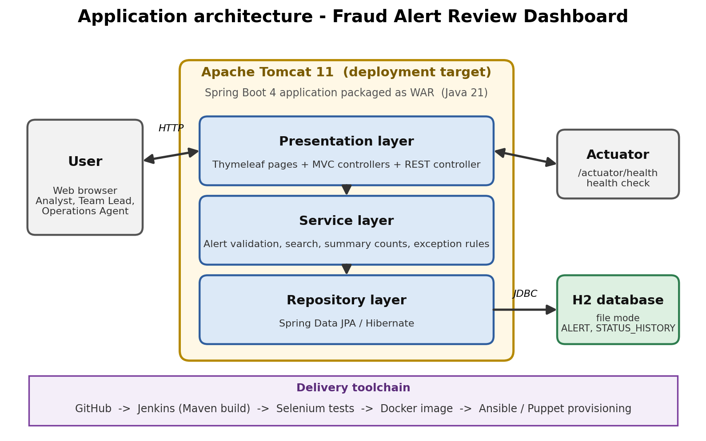
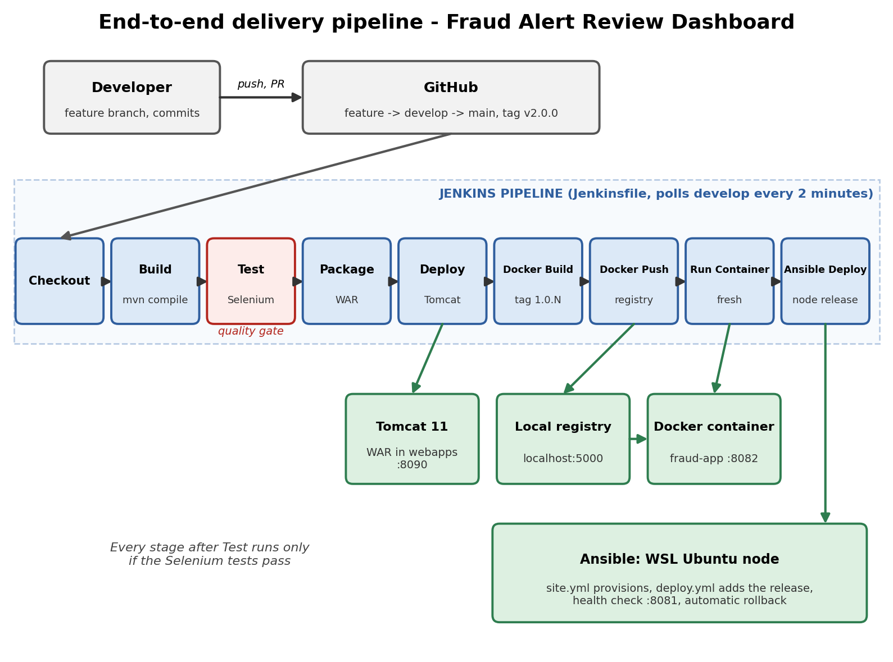

# Technical guide

## 1. Overview

The Fraud Alert Review Dashboard is a Spring Boot web application. The repository also holds everything needed to build, test, containerise, deploy and provision it, so that a commit to GitHub ends as a running, tested application.

## 2. Application architecture



- **Presentation layer:** Thymeleaf pages and MVC controllers (`AlertController`, `DashboardController`).
- **Service layer:** `AlertService` holds validation helpers, search, status counts and the exception rule (high risk, or overdue, and not closed).
- **Repository layer:** Spring Data JPA (`AlertRepository`) on an H2 file database.
- **Health check:** Spring Boot Actuator at `/actuator/health`.

Data model: table `ALERT` (transaction ID, customer, amount, risk level, status, reason, due date, created time).

## 3. Delivery pipeline



| Stage | What it does |
|-------|--------------|
| Checkout | Gets the branch from GitHub |
| Build | `mvn clean compile` |
| Test | `mvn test -Pselenium`: five Selenium journeys and the context test; publishes the JUnit report and failure screenshots; a failure stops every later stage |
| Package | `mvn package -DskipTests`, archives the WAR |
| Deploy | Copies the WAR to Tomcat (`TOMCAT_HOME`, `TOMCAT_PORT` are parameters) |
| Docker Build | Builds image `localhost:5000/fraud-alert-dashboard:1.0.<build>` and `latest` |
| Docker Push | Pushes both tags to the local registry |
| Run Container | Removes the old `fraud-app` container, pulls the new image, starts a fresh container on port 8082 |
| Ansible Deploy | Runs `site.yml` and `deploy.yml` in WSL Ubuntu: provisions the node, deploys the tested WAR as release `1.0.<build>`, runs the health check and rolls back automatically on failure |

Jenkins polls `develop` every 2 minutes (`pollSCM`). The Jenkins tool names must be `JDK-21` and `Maven-3.9.16`.

The Ansible Deploy stage calls `wsl -d Ubuntu`, so the Jenkins service must run as the developer's Windows account, and the Ubuntu user needs passwordless sudo (one-time setup: `echo "$USER ALL=(ALL) NOPASSWD:ALL" | sudo tee /etc/sudoers.d/ansible-jenkins`). Keep an Ubuntu window open so WSL keeps the node running.

## 4. Branching and release process

- `main` holds releases only and is protected (pull request required, no force push, no deletion).
- `develop` is the integration branch. Feature branches are `feature/<issue>-<name>`, documentation branches are `docs/<name>`.
- Commit messages use `type: summary` (feat, fix, docs, test, chore, ci).
- Release: pull request from `develop` into `main`, then an annotated tag, for example `v2.0.0`.

## 5. Configuration management (Ansible)

Run inside Ubuntu on WSL 2 from a copy of the `ansible` folder in the Linux home directory. The pipeline copies the folder from the Jenkins workspace and runs `site.yml` and `deploy.yml` automatically; the commands below are for manual runs.

| Playbook | Purpose |
|----------|---------|
| `site.yml` | Provisions the node: Java 21, `fraudapp` user, folders, environment file, systemd service |
| `deploy.yml` | Deploys a WAR to `releases/<version>`, switches the `current` link, restarts the service, runs the health check and rolls back automatically if it fails |
| `teardown.yml` | Removes everything for a clean node |

```
ansible-playbook -i inventory.ini site.yml -K
ansible-playbook -i inventory.ini deploy.yml -K -e release_version=2.0.0 -e war_src=/path/to/app.war
```

## 6. Troubleshooting guide

| Problem | Cause | Fix |
|---------|-------|-----|
| Jenkins and the application both want port 8080 | Jenkins uses 8080 | Application on 8081, Tomcat on 8090, container on 8082 |
| `Invalid tool` error in the pipeline | Names in the Jenkinsfile do not match Manage Jenkins > Tools | Use the exact names `JDK-21` and `Maven-3.9.16` |
| `session not created: Edge failed to start` in Jenkins | Edge cannot start under the Windows system account used by the Jenkins service | Run the Jenkins service as the developer's Windows account |
| Selenium test reads the old page or cannot find a field | The test read the page before navigation finished | Use `clickAndWait` in `BaseSeleniumTest` |
| Test fails on `endsWith("/alerts")` | Tomcat can add `;jsessionid=...` to the redirect URL | Check with `contains("/alerts")` |
| `mvn test` fails with a database lock | The H2 file is in use by a running local application | Stop `mvn spring-boot:run` before running tests |
| `docker` not recognized or cannot connect in Jenkins | Docker Desktop is not running, or the Jenkins service started before Docker was installed | Start Docker Desktop and restart the Jenkins service |
| `COPY target/*.war` fails during `docker build` | The WAR has not been built | Run `mvn clean package -DskipTests` first |
| Ansible tries to run `inventory.ini` as a script | Files on `/mnt/c` look executable in WSL | Copy the `ansible` folder to the Linux home directory |
| `ansible-playbook -K` times out at "Gathering Facts" | The default `sudo-rs` in new Ubuntu releases does not work with Ansible's password prompt handling | `sudo update-alternatives --set sudo /usr/bin/sudo.ws` |
| Ansible Deploy stage fails in Jenkins (`wsl` not found, or `sudo` asks for a password) | The Jenkins service is not running as the developer account, or sudo needs a password | Run the Jenkins service as the developer account and add the passwordless sudo rule for the Ubuntu user |
| Ansible Deploy fails with connection or health check errors after a while | WSL stopped the distribution when no Ubuntu window was open | Keep an Ubuntu window open during the run |
| Pull request shows merge conflicts | Two branches edited the same lines | Merge `develop` into the feature branch, keep both changes, rebuild, commit, push |
| Direct push to `main` is rejected | Branch protection | Open a pull request from `develop` |

## 7. Limitations

- Dummy data only; no integration with real alert sources.
- H2 file database is for development, not production.
- No login or user roles.
- Jenkins polls GitHub because it runs on localhost and cannot receive webhooks.
- The Jenkinsfile uses Windows commands (`bat`).
- The registry has no authentication or TLS, and secrets are not managed.
- The Ansible target is an Ubuntu instance on WSL 2 on the same laptop, not a separate server, and the Ubuntu user has passwordless sudo for the pipeline (lab setting only).
- Selenium tests cover five user journeys and run in one browser (Edge).
- Monitoring is limited to the health check.

## 8. Future enhancements

- Spring Security with user roles and an audit trail of status changes.
- Move to PostgreSQL and add database migrations.
- Status update workflow and e-mail or SMS notifications for escalated alerts.
- Real alert ingestion through a REST API or message queue, and machine-learning risk scoring.
- GitHub webhooks (through a tunnel or a public Jenkins server) instead of polling.
- Linux Jenkins agents, image vulnerability scanning and a private registry with authentication.
- Deploy to Kubernetes and add monitoring with Prometheus and Grafana.
- Run Ansible against a remote server and add blue-green or canary releases.
